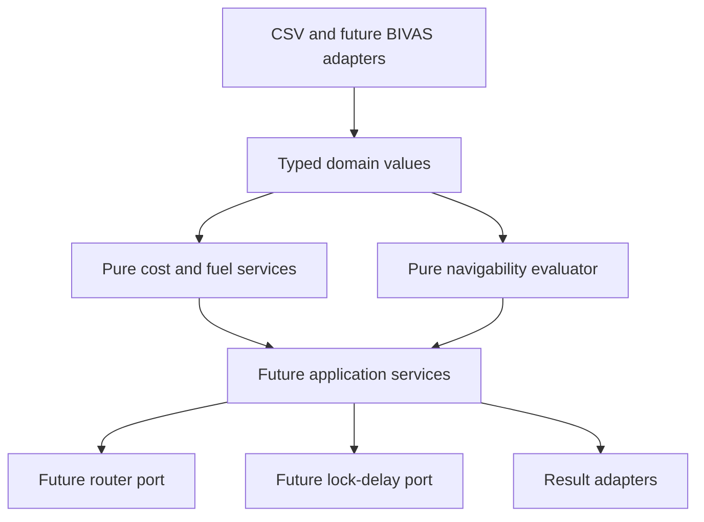

# Architecture

## Contents

1. [Purpose](#purpose)
2. [Layers](#layers)
3. [Dependency rules](#dependency-rules)
4. [Performance path](#performance-path)

## Purpose

Use readable domain contracts with replaceable input, routing and lock-delay adapters. Keep numerical behaviour testable without private data or third-party simulation packages.

[Back to contents](#contents)

## Layers

Current packages:

- `domain`: enums, classifications and frozen value objects, including navigability contracts;
- `costs`: fuel-provider protocol, audited table provider and calculators;
- `navigability`: hard-restriction evaluator, arc masks and the choice-weight guard;
- `io`: pandas CSV boundaries, notebook preparation and flat result records.

[Back to contents](#contents)

## Dependency rules

The core does not import pandas, file readers, NetworkX, SciPy or OpenTNSim. The I/O layer may import pandas. Routing and OpenTNSim will enter through protocols in later work packages.

`navigability` and `costs` do not import each other. Routing combines them only through `restrict_choice_weights`, which makes blocked arcs infinite, so no monetary value or penalty can override a hard restriction.

Reported values never contain calibration or relaxable-constraint penalties. Choice values carry those penalties separately.

[Back to contents](#contents)

## Performance path

The scalar API is the readable reference. `calculate_arc_costs` assembles NumPy vectors for batches and must match scalar results. Later routing work will precompute one cost vector per trip class and season, then reuse directed CSR graph searches by origin.

Run the benchmark before making performance claims.

[Back to contents](#contents)

