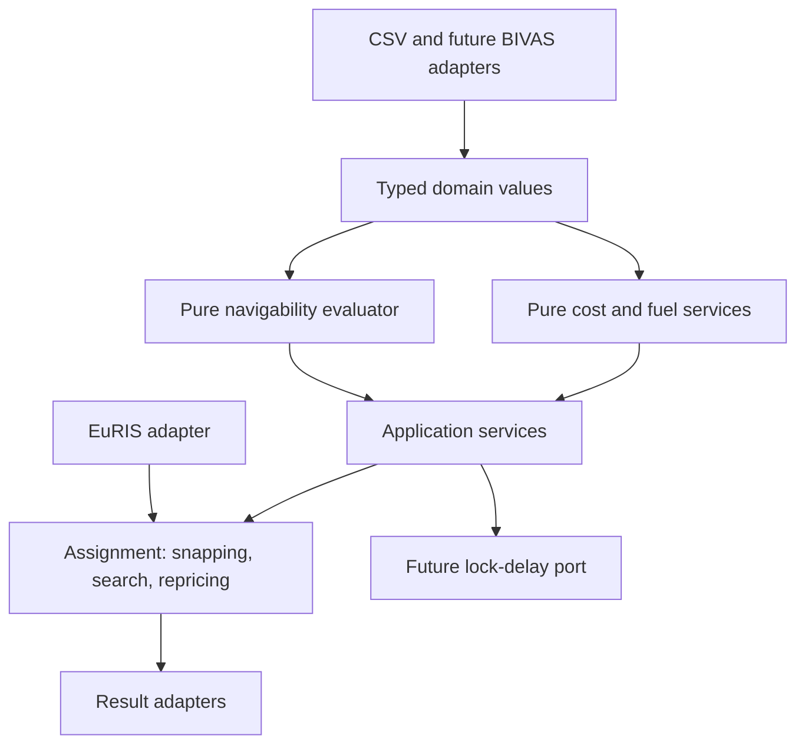

# Architecture

## Contents

1. [Purpose](#purpose)
2. [Layers](#layers)
3. [Dependency rules](#dependency-rules)
4. [Performance path](#performance-path)

## Purpose

Use readable domain contracts with replaceable input, routing and lock-delay adapters. Keep numerical behaviour testable without private data or third-party simulation packages.

[Back to contents](#contents)

## Layers

Current packages:

- `domain`: enums, classifications and frozen value objects, including navigability contracts;
- `costs`: fuel-provider protocol, audited table provider and calculators;
- `navigability`: physical-limit evaluator, arc masks and the choice-weight guard;
- `assignment`: network contract, snapping, penalties, cost-weighted search and repricing;
- `io`: pandas CSV boundaries, the EuRIS adapter, trip reading for assignment, notebook preparation and result writers.

[Back to contents](#contents)

## Dependency rules

The core (`domain`, `costs`, `navigability`) does not import pandas, file readers, NetworkX, SciPy or OpenTNSim. The `assignment` layer may use NumPy, SciPy, pandas, GeoPandas and Shapely, but reads no files. The I/O layer reads and writes files and may import pandas and NetworkX. OpenTNSim will enter through a protocol in a later work package.

`navigability` and `costs` do not import each other. The assignment combines them. Navigability findings and route preferences become penalty hours in `relaxation_penalty_time_h`, and the cost function prices that time. Every penalty is reported with the limit behind it. `restrict_choice_weights` remains available for a strict analysis that forbids blocked arcs.

Reported values never contain calibration or relaxable-constraint penalties. Choice values carry those penalties separately.

[Back to contents](#contents)

## Performance path

The scalar API is the readable reference. `calculate_arc_costs` and the assignment both use `calculate_arc_cost_arrays`, and must match scalar results. The assignment computes one weight vector per routing key and runs SciPy CSR Dijkstra searches per block of origins.

Run the benchmark before making performance claims.

[Back to contents](#contents)

