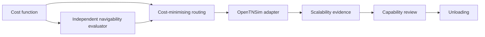

# IWW route assignment documentation

## Contents

1. [Status](#status)
2. [Documentation map](#documentation-map)
3. [Find by task](#find-by-task)
4. [Delivery roadmap](#delivery-roadmap)

## Status

The project is pre-alpha. Version 0.2 provides cargo-independent fuel resolution, weekly and extended IVS adapters, directed supplied sequences and complete-trip costing. Version 0.3 adds an independent navigability evaluator for supplied arcs and routes. Version 0.4 adds traffic assignment: IVS trips are routed over the EuRIS network, the route search minimises the cost function, and physical limits enter route choice as penalties that are always reported.

[Back to contents](#contents)

## Documentation map

Every document in the repository is listed here. If a page is not in this table, it is not part of the maintained documentation set.

| Document | Location | Answers |
| --- | --- | --- |
| Project overview | [`README.md`](../README.md) | What is this, how do I install and run it. |
| Documentation index | `docs/index.md` | Which document do I need. |
| Architecture | [`docs/architecture.md`](architecture.md) | How are the layers separated and what may import what. |
| Cost module | [`docs/cost-module.md`](cost-module.md) | Which formulas are applied and what is assumed. |
| Navigability | [`docs/navigability.md`](navigability.md) | Which physical limits are checked and how they become route-choice penalties. |
| Traffic assignment | [`docs/assignment.md`](assignment.md) | How trips are routed, how the cost function chooses the route and what each output holds. |
| EuRIS inputs | [`docs/euris-inputs.md`](euris-inputs.md) | Which EuRIS files and columns build the network and its limits. |
| Case configuration | [`docs/configuration.md`](configuration.md) | How do I write a run TOML and what does each key do. |
| Data contracts | [`docs/data-contracts.md`](data-contracts.md) | Which columns are required and what does each one drive. |
| Enumerations | [`docs/enumerations.md`](enumerations.md) | Which values are allowed and what does each value mean. |
| Examples | [`docs/examples.md`](examples.md) | How do I run the synthetic example, a case and the benchmark. |
| Verification | [`docs/verification.md`](verification.md) | How is the arithmetic checked against hand calculations. |
| Development | [`docs/development.md`](development.md) | How do I set up, check and build the package. |
| Schema templates | [`schemas/README.md`](../schemas/README.md) | What is each header-only CSV template for. |
| Reference-data status | [`data/README.md`](../data/README.md) | Why is the fuel table absent and what replaces it. |

[Back to contents](#contents)

## Find by task

| I want to | Start at |
| --- | --- |
| Run a first calculation | [Examples](examples.md#synthetic-repository-example) |
| Assign trips to the network | [Traffic assignment](assignment.md#running-it) |
| Choose a route-search metric or penalty | [Assignment settings](assignment.md#settings) and [penalties](assignment.md#penalties) |
| Understand a voyage status | [Voyage status](enumerations.md#voyage-status) |
| Set up a case of my own | [Case configuration](configuration.md) |
| Understand a run option such as `fuel_policy` | [Enumerations](enumerations.md#fuel-resolution-policy) |
| Fix a rejected input file | [Data contracts](data-contracts.md) and [schemas](../schemas/README.md) |
| Understand a result column | [Arc results](data-contracts.md#arc-results) |
| Check where an assumption is applied | [Scenario parameters](configuration.md#where-each-scenario-parameter-is-used) |
| Verify a number by hand | [Cost module](cost-module.md#formula) |
| See the verification evidence | [Verification](verification.md) |
| Judge whether a result is trustworthy | [Confidence](enumerations.md#confidence) |
| Extend the code | [Architecture](architecture.md) and [Development](development.md) |

[Back to contents](#contents)

## Delivery roadmap

Every applied work package uses the illustrative case before a production case.

[Back to contents](#contents)

