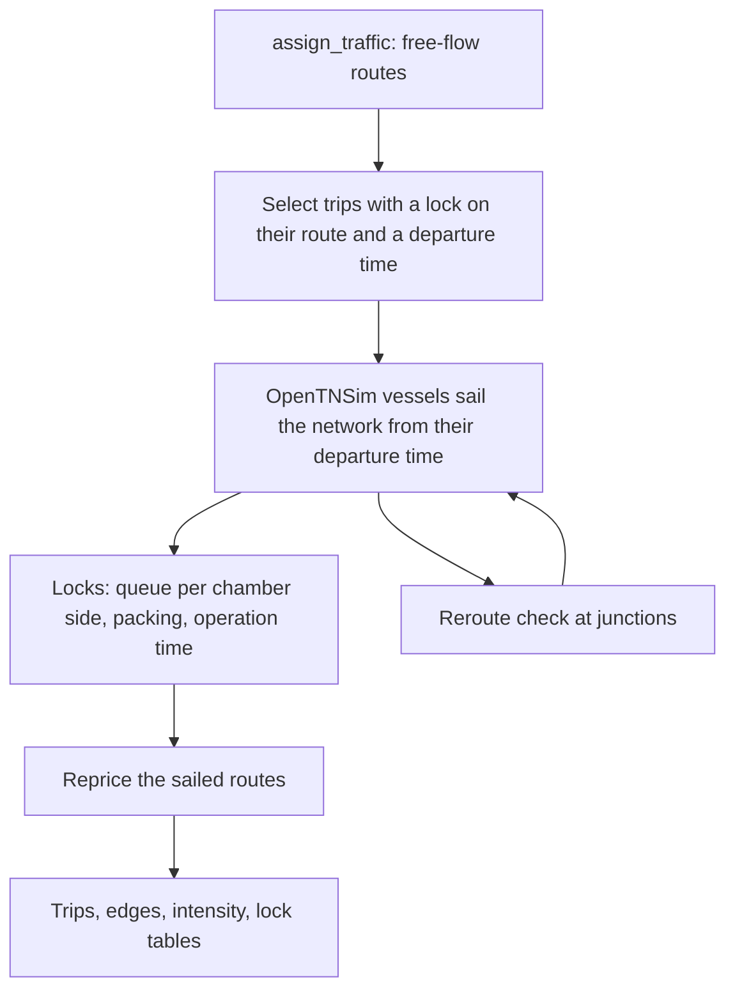

# Lock queue simulation

## Contents

1. [In short](#in-short)
2. [Install](#install)
3. [Inputs](#inputs)
4. [How a run works](#how-a-run-works)
5. [Rerouting](#rerouting)
6. [Settings](#settings)
7. [Outputs](#outputs)
8. [Inspecting a trip](#inspecting-a-trip)
9. [Run time](#run-time)
10. [Running it](#running-it)
11. [Assumptions and limits](#assumptions-and-limits)

## In short

The assignment routes every trip with free-flow weights, so locks only add a fixed passage time. The lock simulation replays the assigned trips in time. Vessels queue for lock chambers, and a vessel that expects a long wait can take another route. The routes that were sailed are priced again with the waiting and chamber time of every passage.

The simulation is optional. `assign_traffic` without a `simulator` gives exactly the free-flow assignment. The simulation uses OpenTNSim vessels on the assignment network and a simple lock model: chambers with a queue per side, no gates and no lock-keeper process. OpenTNSim's own lock module is not used.

[Back to contents](#contents)

## Install

```powershell
poetry install --extras "dev simulation"
```

The `simulation` extra holds OpenTNSim, packer2d and simpy. The packages `domain`, `assignment` and `io` never import them. Only `iww_route_assignment.simulation` does.

[Back to contents](#contents)

## Inputs

| Input | Source | Used for |
| --- | --- | --- |
| Lock complexes | `locks.geoparquet`: `id`, `name`, point | name and position of the lock |
| Chambers | `chambers.geoparquet`: `lock_id`, `dim_usable_length`, `dim_gate_width`, `otimemin`, polygon | chamber size and operation time. The number of chambers of a lock is the number of its rows |
| Section links | `edges.geoparquet`: `section_id`, `lock_id` | the edge a lock sits on |
| Departure time | `TripObservation.departure_time` | when each trip starts |

Chamber rules, each counted in the report (`LockData.report`, `summary["simulation"]["lock_data"]`):

- length is `dim_usable_length` and width is `dim_gate_width`, both in metres. A missing or zero value is taken from the chamber polygon: the long and short side of its minimum rotated rectangle, measured in EPSG:3035. A chamber with no usable size is skipped;
- the operation time is `otimemin` in minutes. A missing value becomes 30 minutes (`default_operation_time_min`). Chambers keep their own time;
- a lock without any usable chamber is not simulated and keeps the fixed passage time of the assignment.

Departure time per source:

| Source | Column | Meaning |
| --- | --- | --- |
| Extended IVS | `Eerste_Tijdstip` | time at the first counting point. The route also starts at the first point, so time and place agree. Sailing before that point is not modelled |
| Weekmonitor | `v05_06_begindt_evenement_iso` | time at the origin port (`UNLO_Herkomst`) |

Pass `departure_column` to `read_assignment_trips` to use another column. SAS (`02JAN2023:13:45:00`) and ISO text are read. A value without time of day is read as midnight and gets the note `departure_time_date_only`, because many trips then share one start time. An unreadable value gives no departure time and the note `departure_time_unreadable`. Neither rejects the trip.

[Back to contents](#contents)

## How a run works



1. A lock sits on exactly one edge. The edge comes from the section link. When several edges share a section code, the edge closest to the lock point is used, and `fraction` is the position along the edge. A vessel that sails from `from_node` to `to_node` enters from side A, and the other way round from side B. No node names are used.
2. Only trips whose free-flow route has a lock are simulated. Others keep their route and numbers. Trips without a departure time, or outside `window_start` and `window_end`, are not simulated and are counted in the summary. They do not take part in the queues.
3. A vessel sails each edge at the network speed. At a lock it joins the queue of the chamber with the shortest expected wait among the chambers it fits in.
4. A chamber takes the vessels waiting on its side in queue order. The vessels that share a load are chosen with a 2D packer: the first vessel always enters, vessels are added while they fit, and a vessel that does not fit stops the selection so later vessels cannot overtake it. The chamber then needs its operation time to reach the other side. It crosses empty when only the other side has a queue, and rests when nobody waits. Every chamber starts on `start_side`.
5. A vessel that fits no chamber is **not rejected**. It passes alone, in the largest chamber, and its passage is flagged `oversize`. The route search already penalises such a lock through the limit penalties, as in the assignment. This also keeps a queue from blocking on a vessel that fits nowhere.
6. The sailed routes are priced again with the exact load. For each lock passage, the time in the chamber replaces the fixed passage time of that lock, and the wait is added. Both are reported time, so they carry hourly cost and idle fuel.

[Back to contents](#contents)

## Rerouting

Vessels do not turn back. A vessel considers a reroute at a node where it has another way to go, that is, at least one outgoing edge besides the one it plans to take. It then:

1. adds the expected wait of the locks it knows of ahead on its route (see [Lookahead](#lookahead)). If that is below `reroute_threshold_h`, nothing changes;
2. otherwise searches the cheapest route to its destination with the same weights as the assignment (route metric, penalties, preferences), plus the expected wait on the lock edges it knows of, per direction. Nodes it has already passed are excluded, so the search can only continue forward;
3. switches when the alternative is cheaper by the route metric **and** at least `reroute_threshold_h` faster in choice time (travel time plus penalty hours, including the expected waits).

So a vessel that sees a queue before a lock leaves at the last junction before it, and a gain of five minutes never changes a route. A vessel that is already queued cannot change anymore.

The expected wait at a lock is the time until a chamber is open on the vessel's side, plus a full round trip (two operation times) for every chamber load queued ahead. It uses the state of the queue at the moment of the decision. Vessels that are still sailing towards the lock are not counted, so vessels that leave close together do not see each other (see [Assumptions and limits](#assumptions-and-limits)).

[Back to contents](#contents)

### Lookahead

A vessel does not know every queue in the country. With `lookahead_h` (default 8) it knows the queue at a lock when the lock is within that many hours of sailing: along its own route for the locks on it, and by the shortest sailing time from its position for any other lock. `lookahead_h=None` gives it knowledge of every queue. A shorter lookahead gives fewer reroutes and a vessel that reacts later, at the junction nearest to the queue.

### The search corridor

Searching the whole network at every junction would be slow, and nearly all of it cannot matter. Waits are never negative, so an alternative can only win if its free-flow time is at most that of the current route plus the expected wait, minus `reroute_threshold_h`. By the triangle inequality, a node can only be on such a route when `d(origin, node) + d(node, destination) - d(origin, current)` is within that budget. The two distance vectors are free-flow times that are computed once per vessel state and node and cached. Only locks inside this corridor are asked for a wait, the path search is limited to it, and a junction with no alternative edge inside it needs no search.

The corridor does not change the decisions. With the `travel_time` metric the decisions are identical to a search of the whole network. With `travel_cost_eur` the search can find a clearly faster alternative that a search of the whole network would have missed, because the cheapest route overall is slower. Set `exhaustive_search=True` to search everything and compare. It is slow and only meant for checking.

## Settings

`LockSimulationSettings`:

| Setting | Default | Meaning |
| --- | --- | --- |
| `reroute` | `True` | allow vessels to change route |
| `reroute_threshold_h` | `0.5` | minimum expected wait ahead, and minimum saving, for a reroute (hours) |
| `lookahead_h` | `8.0` | hours of sailing within which a vessel knows the lock queues. `None` for every queue |
| `window_start`, `window_end` | none | simulate only trips departing in `[start, end)` |
| `start_side` | `"A"` | the side every chamber starts on |
| `keep_logbook` | `False` | keep a log of every chamber move (memory heavy) |
| `exhaustive_search` | `False` | search the whole network at every reroute check instead of the corridor. Same decisions, much slower. For validation |

`LockSimulator.from_directory(folder, network, settings)` reads the EuRIS lock files and places the locks. `default_operation_time_min` and `max_distance_m` (a lock further from its edge is not placed) are optional.

[Back to contents](#contents)

## Outputs

With a simulator, `AssignmentResult.tables` holds four more tables, and `write_assignment_outputs` writes them as `<name>.parquet`.

| Table | One row per | Main columns |
| --- | --- | --- |
| `lock_passages` | vessel passing a lock | `trip_id`, `lock_id`, `lock_name`, `chamber`, `side`, `arrival_time`, `entry_time`, `exit_time`, `wait_min`, `service_min`, `oversize` |
| `lock_summary` | lock that was used | `passages`, `oversize_passages`, `mean_wait_min`, `max_wait_min`, `total_wait_h`, `max_queue_a`, `max_queue_b` |
| `planned_edges` | edge of the free-flow route of a simulated trip | `trip_id`, `seq`, `arc_id`, `from_node`, `to_node`, `penalty_h`, `sailed` (also on the sailed route) |
| `reroutes` | reroute | `trip_id`, `time`, `node_id`, `expected_wait_h`, `saving_h`, `old_edges`, `new_edges` |

The trip table gets `simulated`, `n_reroutes`, `lock_waiting_h` and `lock_service_h` (the last two are zero for trips that are not simulated). The edge table and the intensity table get `lock_waiting_h` and `lock_service_h`. `summary.json` gets a `simulation` entry with the trip counts per reason, passages, reroutes, waits, the time span and the lock-data and placement reports. `trips` also has `departure_time`.

[Back to contents](#contents)

## Inspecting a trip

`trip_edges` holds the route that was sailed. `planned_edges` holds the route the free-flow assignment chose. `inspect_trip` puts both on one table with geometry:

```python
from iww_route_assignment.simulation import inspect_trip

result.tables["reroutes"].head()  # pick a trip_id
trip = inspect_trip(result, euris.network, "ivs:2026:563232382008351d229")
trip.groupby("route")["arc_id"].apply(list)  # planned versus sailed
trip.explore(column="route")  # map; shared == False is the detour
result.tables["lock_passages"].query("trip_id == @trip_id")
```

## Run time

The simulation without rerouting is fast: a few seconds for hundreds of trips. Rerouting dominates, and the number of checks grows with the traffic. Measured on the real EuRIS network and lock files, with random trips and placeholder vessel sizes, so only the ratios mean something:

| Trips | Whole-network search | Corridor, no lookahead | Corridor, 8 h lookahead |
| --- | --- | --- | --- |
| 150 | 29 s | 5.5 s | 3.4 s |
| 600 | 334 s | 14 s | 9.5 s |
| 4000 | not finished after 15 min | 120 s | 69 s |

Restrict the run with `window_start` and `window_end` to a week or a month, and use `lookahead_h` to bound the work further.

## Running it

```powershell
poetry run python examples/simulate_lock_queues.py
```

In code:

```python
from iww_route_assignment import assign_traffic
from iww_route_assignment.io import load_euris_inputs
from iww_route_assignment.simulation import LockSimulationSettings, LockSimulator

euris = load_euris_inputs(graph_path, structures_dir)
simulator = LockSimulator.from_directory(
    structures_dir, euris.network, LockSimulationSettings(reroute_threshold_h=0.5)
)
result = assign_traffic(
    trips, euris.network, cost_inputs, catalogue, euris.restrictions, simulator=simulator
)
result.tables["lock_summary"]
```

The lock hook also works with OpenTNSim's own `move`: `Locks.pass_lock(origin, destination, vessel)` is an `on_pass_edge_functions` entry, and `build_opentnsim_graph(network)` gives the graph. The project's `RouteVessel` does the same work on arrays, because the stock `move` looks up all node geometries for every edge.

[Back to contents](#contents)

## Assumptions and limits

- Departure times are the first counting point (extended IVS) or the origin event time (weekmonitor). The trip then sails at network speed, without delays other than locks.
- One crossing takes `otimemin`, whatever the load. Chambers are not shared between lock complexes, and there is no priority for passenger or hazardous cargo.
- Vessels are packed in queue order with a 2D packer on length and beam. Draught and air draught are not simulated here: they stay penalties in route choice.
- Chambers start on side A. The first vessel of a run can therefore wait up to one crossing more or less than in reality.
- Vessels that depart close together do not see each other's queue until they reach the lock, so they all queue. Later vessels see the queue and leave. Counting vessels that are on their way to a lock would reduce this, and is not done.
- With the default lookahead of 8 hours a vessel ignores queues further away. Set `lookahead_h=None` to compare with a vessel that knows every queue.
- Only trips that pass a lock take part. Trips outside the time window or without departure time do not occupy a chamber, which makes waiting at the edges of a period too low.
- The simulation covers the period of the trips given. Filter or use the window for a representative week or month.
- A lock without chambers, or without a section link, keeps the fixed passage time of the assignment.

[Back to contents](#contents)
