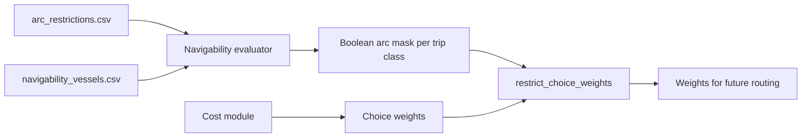

# Navigability evaluator

## Contents

1. [Purpose and scope](#purpose-and-scope)
2. [Separation from costs](#separation-from-costs)
3. [Rules](#rules)
4. [Statuses and findings](#statuses-and-findings)
5. [Inputs](#inputs)
6. [Using the evaluator](#using-the-evaluator)
7. [Assumptions and open points](#assumptions-and-open-points)

## Purpose and scope

The navigability evaluator decides whether one vessel state can physically and legally use a supplied directed arc or route. It covers dimensions, dangerous goods and closures for waterways, bridges, locks and weirs.

It does not search routes, snap locations, model seasons or water levels, simulate locks or compute costs. Limits are supplied per case as a network-state snapshot.

[Back to contents](#contents)

## Separation from costs



The `navigability` package never imports the cost module and produces no monetary value. Routing combines the two only through `restrict_choice_weights`, which sets every blocked arc to infinity. A finite cost or penalty therefore cannot make a blocked arc usable, and a cost never relaxes a hard restriction.

[Back to contents](#contents)

## Rules

Each `ArcRestriction` describes one structure on one arc. An empty limit means that structure imposes no limit of that kind. Each check is independent and all failures are reported, not only the first.

| Restriction | Blocks when | Margin added to vessel value |
| --- | --- | --- |
| `length` | `length_m > max_length_m` | none |
| `beam` | `beam_m + beam_clearance_m > max_beam_m` | `beam_clearance_m` |
| `draught` | `draught_m + under_keel_clearance_m > max_draught_m` | `under_keel_clearance_m` |
| `air_draught` | `air_draught_m + air_clearance_m > max_air_draught_m` | `air_clearance_m` |
| `dangerous_goods` | vessel carries dangerous goods and the structure does not permit them | not applicable |
| `closed` | `is_open` is false | not applicable |

Equality with a limit is navigable. A tolerance of `1e-9` m (`COMPARISON_TOLERANCE_M`) absorbs binary rounding in `value + margin`, so `2.8 + 0.2` against a 3.0 m limit passes.

Limits are maximum permitted vessel values, not water depths or structure heights. Convert a depth or clearance to a permitted value before loading, or express the safety allowance through `NavigabilityMargins`, but not both.

[Back to contents](#contents)

## Statuses and findings

| Status | Meaning | Routing use |
| --- | --- | --- |
| `navigable` | No finding on the arc. | Permitted. |
| `undetermined` | A required value is unknown, or the arc has no restriction rows while coverage is required. | Excluded unless `allow_undetermined=True` is chosen explicitly. |
| `not_navigable` | At least one hard restriction is violated. | Always excluded. |

An arc or route takes its most restrictive status. A route keeps one result per traversal, so repeated arcs remain visible, and `first_blocking_sequence` gives the zero-based position of the first blocked traversal.

Each `NavigabilityFinding` records the arc, structure, restriction, status, the compared `required_m` and `limit_m`, and the restriction source. Navigable checks produce no finding.

Two situations are `undetermined` rather than silently navigable:

- the vessel air draught is unknown and a structure on the arc has a height limit;
- the arc has no restriction rows and `require_coverage=True`, which is the default. The finding has restriction `coverage` and source `restriction_index`.

[Back to contents](#contents)

## Inputs

See [data contracts](data-contracts.md#arc-restrictions) for column definitions and [schemas](../schemas/README.md#navigability-schemas) for templates.

`NavigabilityVessel.from_reference` builds a vessel state from a `VesselReference`. Loaded trips use the full loaded draught, which is conservative for partly loaded vessels. Air draught and dangerous goods must be supplied, because the reference table does not hold them.

Duplicate `(arc_id, structure_id)` pairs and duplicate `vessel_id` values are rejected. The index is sorted by arc, structure type and structure identifier, so results do not depend on input row order.

[Back to contents](#contents)

## Using the evaluator

```python
from iww_route_assignment import (
    NavigabilityMargins,
    build_restriction_index,
    evaluate_route,
    navigable_arc_mask,
    restrict_choice_weights,
)

index = build_restriction_index(restrictions)
result = evaluate_route(route, vessel, index, NavigabilityMargins(under_keel_clearance_m=0.3))
mask = navigable_arc_mask(arc_ids, vessel, index)
weights = restrict_choice_weights(choice_weights, mask)
```

Run the synthetic example with `poetry run python examples/check_route_navigability.py`. `route_navigability_to_frames` returns one summary row per route and vessel and one row per finding.

[Back to contents](#contents)

## Assumptions and open points

1. Rules are transparent physical checks. They are not yet reconciled with BIVAS requirement identifiers, because no machine-readable BIVAS navigability specification is available in the project folders.
2. CEMT class compatibility, seasonal or water-level-dependent limits, convoy formation, one-way traffic and opening schedules for movable bridges are not modelled.
3. Default margins are zero. Case-specific margins are scenario assumptions and must be recorded with each run.
4. Undetermined arcs are excluded by default. Allowing them is an explicit, recorded case choice.

[Back to contents](#contents)

