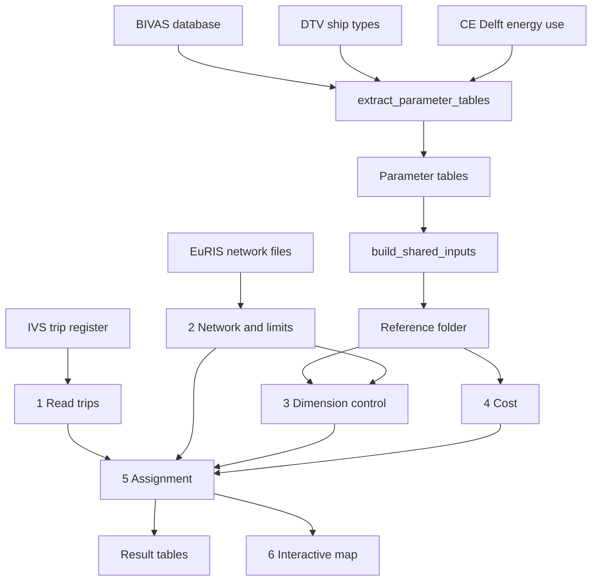
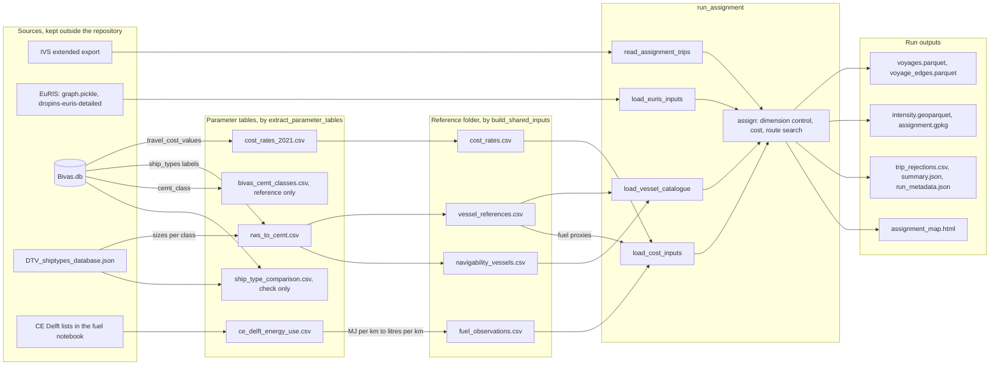

# Workflow

## Contents

1. [In short](#in-short)
2. [The chain](#the-chain)
3. [The data flow, file by file](#the-data-flow-file-by-file)
4. [Fixed and changing inputs](#fixed-and-changing-inputs)
5. [What to run when](#what-to-run-when)
6. [One call](#one-call)
7. [Step by step](#step-by-step)
8. [Preparing the reference tables](#preparing-the-reference-tables)
9. [Checking a run](#checking-a-run)
10. [The interactive map](#the-interactive-map)
11. [Where each function lives](#where-each-function-lives)

## In short

- A trip register goes in. Cheapest routes with their cost and every unmet physical limit come out.
- Three names cover a run: `AssignmentPaths`, `AssignmentConfig` and `run_assignment`.
- Every step is also a function of its own, so one step can be run and checked alone.
- Each written folder holds a report with the checksums of its inputs.

This page shows how the modules connect. Each module has its own page for the detail. [Data lineage](data-lineage.md) names every input by its source name.

[Back to contents](#contents)

## The chain



| Step | Module | Reads | Gives |
| --- | --- | --- | --- |
| Prepare a | `io.reference_build.extract_parameter_tables` | BIVAS database, DTV ship types, CE Delft energy use | four parameter tables |
| Prepare b | `io.reference_build.build_shared_inputs` | the parameter tables | the reference folder |
| 1 Read trips | `io.assignment.read_assignment_trips` | IVS export | valid trips, rejected rows with a reason |
| 2 Network and limits | `io.euris.load_euris_inputs` | EuRIS graph and structure files | network, limits per section |
| 3 Dimension control | `navigability`, `assignment.penalties` | ship dimensions, limits | findings, penalty hours |
| 4 Cost | `costs` | cost rates, fuel, scenario | cost and fuel per section |
| 5 Assignment | `assignment.assign_traffic` | steps 1 to 4 | route per trip, totals, traffic per section |
| 6 View | `io.viewer.write_assignment_map` | the result | one HTML map |

The two preparation steps run only when a source changes. Steps 1 to 6 run in one call.

[Back to contents](#contents)

## The data flow, file by file

Each box is a file or a function, under its real name. Read it left to right.



| File | Made by | Read by | Holds |
| --- | --- | --- | --- |
| `cost_rates_2021.csv` | `extract_parameter_tables` | `build_shared_inputs` | BIVAS cost rates, columns renamed |
| `rws_to_cemt.csv` | `extract_parameter_tables` | `build_shared_inputs` | BIVAS class list joined to DTV sizes |
| `ce_delft_energy_use.csv` | `extract_parameter_tables` | `build_shared_inputs` | energy per km, both CE Delft tables |
| `bivas_cemt_classes.csv` | `extract_parameter_tables` | nothing | BIVAS waterway classes, for reference |
| `ship_type_comparison.csv` | `extract_parameter_tables` | nothing | where BIVAS and DTV ship types differ |
| `cost_rates.csv` | `build_shared_inputs` | `load_cost_inputs` | cost rates per cargo type and vessel class |
| `fuel_observations.csv` | `build_shared_inputs` | `load_cost_inputs` | litres per km at light, medium and heavy load |
| `vessel_references.csv` | `build_shared_inputs` | `load_cost_inputs`, `load_vessel_catalogue` | complete vessel classes, for fuel proxies and the class check |
| `navigability_vessels.csv` | `build_shared_inputs` | `load_vessel_catalogue` | a loaded and an empty state per class, for the dimension check |

[Back to contents](#contents)

## Fixed and changing inputs

A run reads eight inputs. Six are fixed: they stay the same from run to run and change only when the source behind them changes. Two change per run. Once the reference folder, the network and the trips are in place, `run_assignment` can run.

| Input | Kind | What it is | One row is | Comes from | Made by | Used for | Changes when |
| --- | --- | --- | --- | --- | --- | --- | --- |
| `cost_rates.csv` | fixed, reference folder | what one hour, one km and one tonne cost | one cargo type and vessel class | BIVAS `travel_cost_values` | `extract_parameter_tables`, `build_shared_inputs` | step 4: hourly rate, distance cost, fixed cargo cost | BIVAS cost figures or the cost set change |
| `fuel_observations.csv` | fixed, reference folder | fuel burnt per km at light, medium and heavy load | one vessel class on one waterway class | CE Delft energy use, megajoules per km divided by 36 | the same two | step 4: sailing and idle fuel | the CE Delft figures change |
| `vessel_references.csv` | fixed, reference folder | the vessel classes the model knows, each as a whole: waterway class, maximum load, beam, length, both draughts | one vessel class | class list from BIVAS `ship_types`, sizes from DTV | the same two | whether a trip's class is known, the waterway-class preference, the nearest class for a fuel proxy | the BIVAS class list or the DTV sizes change |
| `navigability_vessels.csv` | fixed, reference folder | each class in one loading condition, with the draught and air draught of that condition | one class, loaded or empty | DTV draughts and average height | the same two | step 3: a loaded trip is checked with the loaded state, an empty trip with the empty state | the DTV sizes change |
| `graph.pickle` | fixed, network | the waterway network as sections between nodes | one section | EuRIS | fis-crawler | step 2 and the route search | a new EuRIS export |
| structure folder | fixed, network | locks and bridges with their sizes | one lock chamber or bridge opening | EuRIS | fis-crawler | step 2: lock count, lock and bridge limits | a new EuRIS export |
| trip register | per run | the trips to route | one trip | IVS | the IVS export | step 1 | a new export, period or sample |
| `AssignmentConfig` | per run | the scenario values and the options | not a table | stated by the user | the user | steps 3 to 5, recorded in `run_metadata.json` | scenarios are compared |

A vessel reference describes a class as a whole. A vessel state describes that class loaded or empty, because a loaded ship sits deeper in the water. `navigability_vessels.csv` is optional: without it the dimension check uses the reference sizes and has no air draught.

[Back to contents](#contents)

## What to run when

| When | Call | Writes |
| --- | --- | --- |
| BIVAS, the DTV file or the CE Delft lists change | `extract_parameter_tables(sources, parameters_dir)` | the parameter tables, the ship-type comparison, `build_report.json` |
| Right after that | `build_shared_inputs(parameters_dir, reference_dir)` with a new folder | a new reference folder. It never overwrites one |
| A new trip register, a new EuRIS export or new settings | `run_assignment(paths, config, output_dir)` | the run outputs and the map |
| A quick look at a large register | `AssignmentConfig(sample_size=1000)`, or `period_start` and `period_end` | the same outputs for fewer trips |
| A check of every step on a small case | `module_check_tables(run, cost_rates)` and `largest_hand_difference_eur(tables)` | one table per step |
| A formula change | `pytest tests/verification`, see [Verification](verification.md) | the verification report |

A new EuRIS export needs no preparation step, because the run reads the graph and structure files directly. Check the network report in `run_metadata.json` after the run.

[Back to contents](#contents)

## One call

```python
from iww_route_assignment import (
    AssignmentConfig,
    AssignmentPaths,
    ScenarioCostParameters,
    run_assignment,
)

paths = AssignmentPaths(
    trips="ivs_trips_extended_2026.csv",
    graph="euris-enriched/graph.pickle",
    structures="dropins-euris-detailed",
    reference="reference",
)
config = AssignmentConfig(
    scenario=ScenarioCostParameters(
        fuel_price_eur_per_l=1.20,
        interest_rate_percent=3.0,
        cargo_waiting_time_h=1.0,
        idle_fuel_factor=0.15,
    ),
    cargo_weight_unit="t",
)
run = run_assignment(paths, config, output_dir="output")
print(run.result.summary["status_counts"])
```

- `AssignmentPaths` says where the inputs are. It has no default folder, so nothing hidden is read.
- `AssignmentConfig` holds every choice. The scenario and the cargo unit have no default, because both are assumptions that must be stated. Every other field has a documented default. See [assignment run options](enumerations.md#assignment-run-options).
- `run_assignment` reads, checks, assigns and writes. It returns an `AssignmentRun` with the loaded inputs, the result, the configuration and the written files.

Useful `AssignmentConfig` fields:

| Field | Use |
| --- | --- |
| `settings` | route-search metric, load rounding, point columns, workers |
| `penalties`, `preferences` | penalty hours per limit type |
| `limit_rules` | lock passage time, fairway length limit |
| `period_start`, `period_end` | keep trips that start in this period. The end is exclusive |
| `sample_size`, `sample_seed` | route a fixed random sample for a quick check |
| `fuel_policy` | allow labelled proxies, or stop when fuel is not observed |

On Windows, guard the call with `if __name__ == "__main__":` when `settings.n_workers` is above 1.

[Back to contents](#contents)

## Step by step

The same run in single steps. Each returns plain objects that can be inspected.

```python
from iww_route_assignment.io import assign, load_assignment_inputs, write_assignment_outputs

inputs = load_assignment_inputs(paths, config)  # steps 1 and 2, plus costs and vessels
result = assign(inputs, config)  # steps 3 to 5, no files
write_assignment_outputs(result, "output")  # tables only
```

Single loaders:

| Function | Returns |
| --- | --- |
| `io.read_trip_frame(path)` | the register as text, so identifiers keep their form |
| `io.filter_trips_by_period(frame, start, end)` | rows that start in the period |
| `io.read_assignment_trips(frame, ...)` | `AssignmentTrips` with points and rejected rows |
| `io.load_euris_inputs(graph, structures)` | network, limits and a load report |
| `io.load_cost_inputs(reference, scenario)` | `CostInputs`: cost rates, fuel provider, scenario |
| `io.load_vessel_catalogue(reference, aliases)` | `VesselCatalogue`: dimensions and loading states |

[Back to contents](#contents)

## Preparing the reference tables

```python
from iww_route_assignment.io import ParameterSources, build_shared_inputs, extract_parameter_tables

sources = ParameterSources(
    bivas_db="Bivas.db",
    dtv_ship_types="DTV_shiptypes_database.json",
    energy_notebook="notebooks/create_fuel_consumption_table.ipynb",
)
extract_parameter_tables(sources, "parameters", cost_set=3)
build_shared_inputs("parameters", "reference")
```

- `extract_parameter_tables` writes `cost_rates_2021.csv`, `bivas_cemt_classes.csv`, `rws_to_cemt.csv`, `ce_delft_energy_use.csv`, `ship_type_comparison.csv` and `build_report.json`.
- `build_shared_inputs` writes `cost_rates.csv`, `fuel_observations.csv`, `vessel_references.csv`, `navigability_vessels.csv` and `build_report.json`. It refuses to write into a folder that already holds files.
- Both reports list the checksums of what was read and every rule applied.

[Data lineage](data-lineage.md) gives each column from source to use.

[Back to contents](#contents)

## Checking a run

`io.module_check_tables(run, cost_rates)` returns one table per step, for a small case.

| Table | One row per | Check |
| --- | --- | --- |
| `1_trips` | source row | source columns beside the trip that was read, or the rejection reason |
| `2_network` | used section and limit | length, speed, class, locks, each limit with its source |
| `3_dimension_control` | unmet limit on a sailed section | ship value, limit, status, penalty hours |
| `4_cost` | sailed section | each cost part beside a recomputation from the raw cost-rate row |
| `5_assignment` | trip | status, totals, the recomputed total, the route, and a second run when given |

The recomputation in tables 4 and 5 does not call the cost module. `io.largest_hand_difference_eur(tables)` returns the largest gap. A sound run stays within `HAND_CHECK_TOLERANCE_EUR`, which is 1e-9 EUR.

```python
import pandas as pd
from iww_route_assignment import trace_trip
from iww_route_assignment.io import largest_hand_difference_eur, module_check_tables

tables = module_check_tables(run, pd.read_csv("reference/cost_rates.csv"))
assert largest_hand_difference_eur(tables) < 1e-9
print(trace_trip(run.result, run.result.trips["trip_id"].iloc[0]))
```

`trace_trip` gives one trip section by section: distance, speed, locks, time, each cost part, fuel with its method, and each penalty.

[Back to contents](#contents)

## The interactive map

`io.write_assignment_map(result, network, path)` writes one HTML file. `run_assignment` writes it as `assignment_map.html` unless `write_map=False`.

- One line per used section. Width follows the number of trips.
- The colour follows a chosen measure: trips, cargo, reported cost, fuel, reported time, share of empty trips or penalty hours.
- Layers: used sections, sections with an unmet limit by type, locks, the unused network. On a run too large for the trip picker, the unmet-limit layer starts switched off, so traffic shows first.
- A click on a section shows its figures and each unmet limit with its structure.
- For a run of at most `max_trips` trips, one trip can be picked to see its route. With `other=` a second result, its route is drawn dotted.

The file holds the data. Viewing needs an internet connection for the map library and the background tiles.

[Back to contents](#contents)

## Where each function lives

| Need | Name | Module |
| --- | --- | --- |
| Whole run | `run_assignment`, `AssignmentPaths`, `AssignmentConfig`, `AssignmentRun` | `io.workflow` |
| Load only | `load_assignment_inputs`, `load_cost_inputs`, `load_vessel_catalogue` | `io.workflow` |
| Period filter | `filter_trips_by_period` | `io.workflow` |
| BIVAS tables | `read_bivas_cost_rates`, `read_bivas_cemt_classes`, `read_bivas_ship_types`, `read_bivas_ship_type_table`, `read_bivas_cost_sets` | `io.bivas` |
| Reference tables | `extract_parameter_tables`, `build_shared_inputs` | `io.reference_build` |
| Ship-type sources | `read_dtv_vessel_table`, `compare_ship_type_sources` | `io.reference_build` |
| Checksums and reports | `sha256_file`, `run_metadata`, `write_json` | `io.provenance` |
| Check tables | `module_check_tables`, `largest_hand_difference_eur` | `io.checks` |
| One trip | `trace_trip` | `assignment.trace` |
| Map | `write_assignment_map`, `assignment_map_data` | `io.viewer` |

[Back to contents](#contents)
