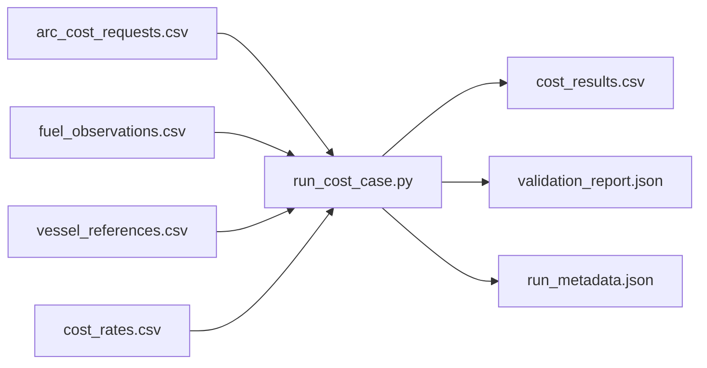
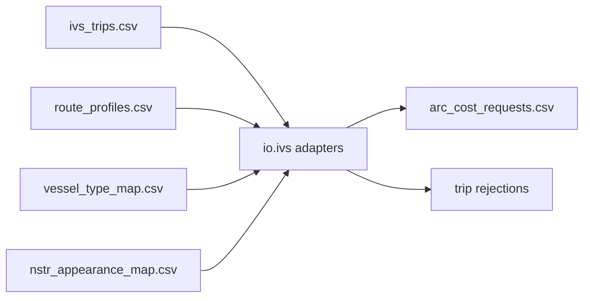

# Schemas

## Contents

1. [Role of this folder](#role-of-this-folder)
2. [File index](#file-index)
3. [Cost-run schemas](#cost-run-schemas)
4. [Trip-preparation schemas](#trip-preparation-schemas)
5. [Rules that apply to every file](#rules-that-apply-to-every-file)

## Role of this folder

Each file here is a header-only CSV template. It carries the required column names in the expected order and no data rows.

The folder exists because the repository never holds production or reference data, yet the column contracts must still be versioned, reviewable and diffable. A schema file is therefore the machine-readable half of the [data contracts](../docs/data-contracts.md); the prose half explains meaning, units and validation.

Use a schema file in three ways:

1. Copy it into a case folder and fill in rows to create a valid input.
2. Compare it against an existing file to find a renamed or missing column.
3. Read the header to see the exact spelling the loaders require, including the abbreviated BIVAS column names in `cost_rates.csv`.

The templates are not validated fixtures. Synthetic, licence-safe test data lives in `tests/fixtures/`.

[Back to contents](#contents)

## File index

| File | Consumed by | Purpose |
| --- | --- | --- |
| `arc_cost_requests.csv` | `run_cost_case.py`, `[inputs].arcs` | One row per arc to cost. |
| `fuel_observations.csv` | `load_fuel_observations_csv` | Observed litres per hour by vessel, waterway and profile. |
| `vessel_references.csv` | `load_vessel_references_csv` | Vessel attributes for deterministic proxy selection. |
| `cost_rates.csv` | `load_cost_rates_csv` | BIVAS rates per appearance and vessel class. |
| `ivs_trips.csv` | `load_ivs_trips_csv` | IVS trip-register export used to derive arc requests. |
| `route_profiles.csv` | `load_route_profiles_csv` | Distance, waterway class and speed per origin-destination pair. |
| `vessel_type_map.csv` | `load_vessel_type_map_csv` | Numeric IVS ship type to RWS vessel class. |
| `nstr_appearance_map.csv` | `load_appearance_map_csv` | NSTR chapter to cargo appearance, with a source column. |

[Back to contents](#contents)

## Cost-run schemas

The first four files are the four `[inputs]` keys of a [case configuration](../docs/configuration.md#inputs-section). Together they are sufficient to produce costs; no other file is read during a cost run.

[Back to contents](#contents)

## Trip-preparation schemas

The last four files belong to the upstream step that turns an observed trip register into arc-cost requests. That step is optional: a case may author `arc_cost_requests.csv` directly.

`ivs_trips.csv` keeps the original Dutch export column names, because renaming them at the source would break traceability to the register. The adapter maps them to typed fields and records the mapping in `IVS_COLUMNS`. Rejected trips are reported with a coded reason from [Trip rejection reason](../docs/enumerations.md#trip-rejection-reason) rather than dropped.

[Back to contents](#contents)

## Rules that apply to every file

- Write files with `index=False`. A generated `Unnamed: 0` column is rejected by the loaders.
- Column order in a real input file is free; the header spelling is not.
- An empty table is rejected, as is a missing required value in a required column.
- Duplicate keys are rejected rather than resolved by row order. This applies to the fuel key, the cost-rate key, the vessel-type mapping and the appearance mapping.
- Controlled values such as CEMT classes and vessel profiles must match [Enumerations](../docs/enumerations.md).
- Do not commit filled versions of these files unless the content is synthetic and licence-safe.

[Back to contents](#contents)

